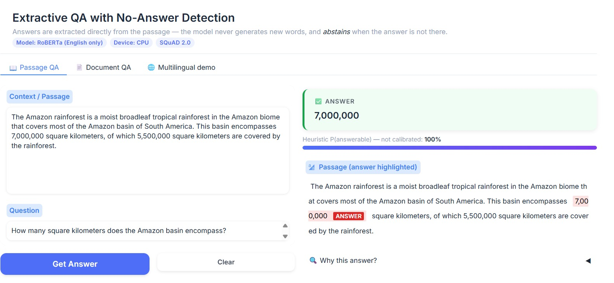
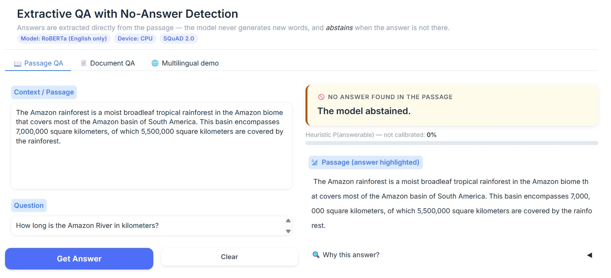
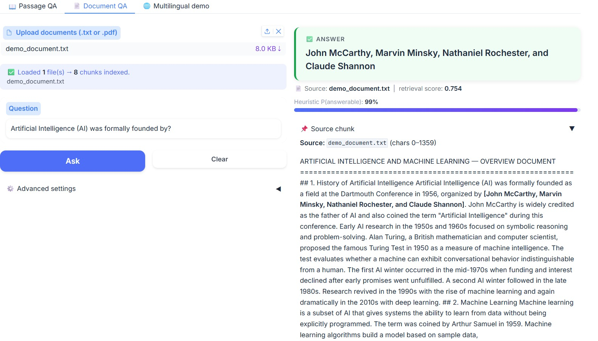
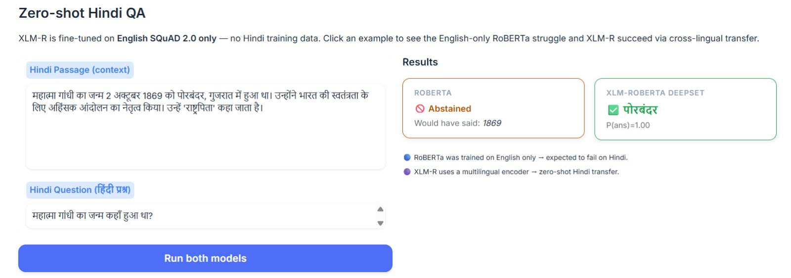
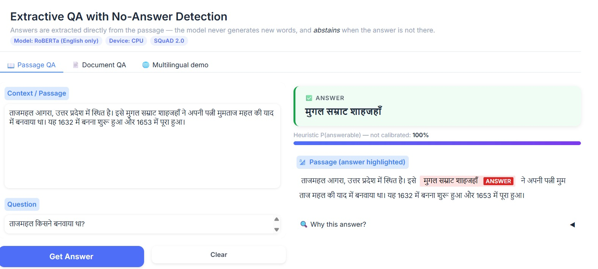

# Extractive QA with No-Answer Detection — Topic 180

> Given a passage and a question, the system extracts the **exact answer span** from the text — or **abstains** if the answer is not there. It never generates new words.

---

## Table of Contents

1. [What This Project Does](#1-what-this-project-does)
2. [The Inception Problem — Why This Exists](#2-the-inception-problem--why-this-exists)
3. [How It Works — Technical Overview](#3-how-it-works--technical-overview)
4. [Features](#4-features)
5. [Project Structure](#5-project-structure)
6. [Setup](#6-setup)
7. [Running the Demo](#7-running-the-demo)
8. [All Commands](#8-all-commands)
9. [Evaluation Metrics](#9-evaluation-metrics)
10. [Document QA — Retriever + Reader](#10-document-qa--retriever--reader)
11. [Calibration](#11-calibration)
12. [Multilingual Extension — Fine-tuning + Hindi](#12-multilingual-extension--fine-tuning--hindi)
13. [Results](#13-results)
14. [Jury Q&A](#14-jury-qa)
15. [Test Data](#15-test-data)
16. [Hardcoded Values Reference](#16-hardcoded-values-reference)
17. [Limitations](#17-limitations)
18. [Pre-Presentation Checklist](#18-pre-presentation-checklist)
19. [Troubleshooting](#19-troubleshooting)

---

## Screenshots

| Passage QA — Answer found | Passage QA — Model abstains |
|:---:|:---:|
|  |  |

| Document QA — Multi-file retriever + reader | Multilingual — RoBERTa vs XLM-R on Hindi |
|:---:|:---:|
|  |  |

| Passage QA — Hindi answer with Devanagari highlight |
|:---:|
|  |

---

## 1. What This Project Does

This is a **complete extractive question-answering system** built on SQuAD 2.0 with five major components:

| Component | What it does |
|---|---|
| **Core QA engine** | Runs `deepset/roberta-base-squad2` on a passage, extracts a span or abstains |
| **Confidence calibration** | Fits Platt/isotonic calibrators so confidence scores are real probabilities |
| **Document QA pipeline** | Retriever + reader: embeds document chunks, finds relevant ones, runs QA on them |
| **Multilingual extension** | Fine-tunes XLM-R on SQuAD 2.0 for zero-shot Hindi QA |
| **Polished Gradio demo** | Three-tab UI with two-column layout, answer cards, confidence bars, Hindi support |

The model **never generates new words**. It reads the passage and draws a box around the answer — or refuses to answer if the answer is not in the text.

---

## 2. The Inception Problem — Why This Exists

This is the central motivating example.

**Passage:**
> *Inception is a 2010 science fiction action film starring Leonardo DiCaprio. The film was a major commercial success, grossing over $836 million worldwide.*

**Question:** Who directed the film Inception?

| | Answer |
|---|---|
| **Review 1** (SQuAD 1.1 model) | `Leonardo DiCaprio` ❌ — wrong and confidently wrong |
| **Review 2** (SQuAD 2.0 model) | `No answer found in the passage.` ✅ — correct |


*Green answer card: the model extracts the correct span and highlights it in the passage.*


*Amber no-answer card: the model correctly refuses to answer when the answer is not in the passage.*

**Why Review 1 fails:** The SQuAD 1.1 model was trained on 100k questions that all have answers. It learned to always extract something. It found "Leonardo DiCaprio" — a person's name, the right *type* for a "who" question — but the completely wrong *person*. The director (Christopher Nolan) is not mentioned anywhere.

**Why Review 2 works:** SQuAD 2.0 adds ~50k adversarially constructed *unanswerable* questions. Each has a passage that looks like it should contain the answer (a person's name, a number) but doesn't. Training on these teaches the model to abstain.

The fix lives in one equation:

```
null_score  = start_logit[CLS] + end_logit[CLS]
best_score  = start_logit[s]   + end_logit[e]    (best real span)
score_diff  = null_score − best_score

abstain  if  score_diff > threshold
answer   otherwise
```

---

## 3. How It Works — Technical Overview

### BERT-style span extraction

```
Input:  [CLS] question tokens [SEP] context tokens [SEP]
            │
        Transformer encoder (RoBERTa / XLM-R)
            │
        One start logit + one end logit per token
            │
        Best span = max(start[s] + end[e])  for s ≤ e,  e−s+1 ≤ 30 tokens
                    restricted to context tokens only (via sequence_ids)
```

The model never generates text — it just points at a contiguous span that is already in the passage.

### No-answer decision rule (`decoding.py → decide()`)

```python
def decide(null_score, best_span_score, threshold=0.0):
    score_diff = null_score - best_span_score
    return score_diff > threshold, score_diff
```

- `score_diff > 0` → model prefers "no answer"
- `score_diff > threshold` → model **abstains**
- Threshold tunable: lower = abstains more, higher = answers more

### Long-passage windowing

BERT-style models accept at most 384 tokens. For longer passages:
- Tokeniser produces **overlapping windows** (stride = 128 tokens)
- Best span is taken **across all windows** (highest combined logit)
- Null score is the **minimum across all windows** (most conservative — if any window is confident there is no answer, that wins)

This is the official SQuAD 2.0 recipe from HuggingFace.

---

## 4. Features

### Core engine
- ✅ Extractive QA with no-answer detection (SQuAD 2.0)
- ✅ Tunable `score_diff` threshold (`tune_threshold.py` or demo slider)
- ✅ Overlapping windows for long passages
- ✅ Returns answer text, character offsets, top candidates, confidence
- ✅ Optional calibrated probability when `calibrator.pkl` exists

### Evaluation
- ✅ Official SQuAD EM / F1 with HasAns / NoAns breakdown (`evaluate_squad.py`)
- ✅ Before-vs-after comparison with Review 1 model (`compare_models.py`)
- ✅ Full dev-set demo mode (11,873 examples, official numbers, `eval_report.py --demo`)

### Document QA
- ✅ Load `.txt` and `.pdf` files, chunk with overlap, embed with `BAAI/bge-small-en-v1.5`
- ✅ Top-k retrieval by cosine similarity, best-wins aggregation
- ✅ Recall@1/3/5 + end-to-end EM/F1 evaluation (`evaluate_retrieval.py`)

### Calibration
- ✅ Platt scaling and isotonic regression on `answerable_prob`
- ✅ ECE and Brier score reporting
- ✅ Reliability diagram + risk-coverage curve PNGs
- ✅ `calibrated_prob` field added to `answer()` output automatically

### Multilingual
- ✅ Fine-tune XLM-R on SQuAD 2.0 (`train_qa.py`) — Colab-ready (fp16, gradient accumulation)
- ✅ Zero-shot Hindi evaluation on XQuAD + MLQA (`evaluate_multilingual.py`)
- ✅ Hindi-aware normalization in `metrics.py` (NFC, danda stripping, no article removal)
- ✅ 10 answerable + 10 unanswerable Hindi hand-made samples (`hindi_samples.py`)
- ✅ Per-language threshold files (`threshold.json` / `threshold_hi.json`)

### Demo UI (Gradio)
- ✅ Two-column layout — inputs left, results right, no scrolling
- ✅ Green/amber answer result cards with confidence progress bar
- ✅ "Why this answer?" collapsible accordion (score_diff, candidates, rejected span)
- ✅ Advanced settings collapsed by default (threshold, model, language dropdowns)
- ✅ Document QA tab with file chips, chunk-count status, source highlighting
- ✅ Multilingual tab with side-by-side pass/fail cards
- ✅ Soft theme (Inter + Noto Sans Devanagari, rounded corners, dark mode)
- ✅ Hindi text renders and highlights correctly

### Testing
- ✅ 11/11 offline tests (`python test_all.py --offline`) — no model or internet needed

---

## 5. Project Structure

```
topic180_qa_v2/
│
├── Core
│   ├── qa_engine.py          QA engine — model loading, windowed inference, decision rule
│   ├── decoding.py           Pure-numpy span search + no-answer rule (testable offline)
│   ├── metrics.py            SQuAD EM/F1 + Hindi-aware normalization
│   └── sample_data.py        8 answerable + 8 unanswerable hand-made English examples
│
├── Evaluation
│   ├── evaluate_squad.py     SQuAD 2.0 dev evaluation (EM/F1, HasAns/NoAns)
│   ├── evaluate_samples.py   Quick eval on hand-made samples
│   ├── compare_models.py     Before (Review 1) vs After (Review 2) table
│   ├── eval_report.py        Full-dev table + threshold sweep + plots
│   └── load_squad.py         Dataset explorer + statistics
│
├── Threshold tuning
│   └── tune_threshold.py     Grid-search best threshold, save threshold.json
│                             --lang hi → threshold_hi.json (tiny, rough)
│
├── Document QA (Part A)
│   ├── retriever.py          .txt/.pdf loader, chunker, dense embedder (BGE-small)
│   ├── doc_qa.py             DocQA class — retriever + reader + best-wins aggregation
│   ├── evaluate_retrieval.py Recall@1/3/5 + end-to-end EM/F1 on SQuAD corpus
│   └── demo_document.txt     Sample AI/ML document for demo uploads
│
├── Calibration (Part B)
│   └── calibration.py        Platt + isotonic calibration, ECE/Brier, plots
│
├── Multilingual (Part C)
│   ├── train_qa.py           Fine-tune XLM-R on SQuAD 2.0 (Colab-ready)
│   ├── evaluate_multilingual.py  English + Hindi (XQuAD/MLQA) comparison table
│   ├── hindi_samples.py      10 answerable + 10 unanswerable Hindi QA pairs
│   └── hindi_sanity.py       Sanity-check script on hindi_samples
│
├── Demo
│   ├── demo_app.py           Gradio UI — Passage QA / Document QA / Multilingual
│   └── ui_style.css          Custom CSS (typography, cards, confidence bar, dark mode)
│
└── Infrastructure
    ├── test_all.py           11-test verification script (--offline safe)
    └── requirements.txt      All dependencies
```

**Generated at runtime** (not committed):
`threshold.json`, `threshold_hi.json`, `calibrator.pkl`, `calibration_cache.json`,
`reliability_diagram.png`, `risk_coverage.png`, `threshold_sweep.png`,
`checkpoints/xlmr_squad2/`

---

## 6. Setup

### Requirements

```bash
pip install -r requirements.txt
```

| Package | Purpose |
|---|---|
| `transformers>=4.40.0` | Model loading and tokenization |
| `torch>=2.0.0` | Inference backend |
| `datasets>=2.19.0` | SQuAD 2.0 loading from HuggingFace Hub |
| `gradio>=4.0.0` | Demo web UI |
| `sentence-transformers>=2.7.0` | Document chunk embedding (Document QA) |
| `pypdf>=4.0.0` | PDF loading (Document QA) |
| `scikit-learn>=1.3.0` | Platt scaling and isotonic regression (Calibration) |
| `numpy>=1.24` | Span decoding arithmetic |
| `matplotlib>=3.7.0` | Threshold sweep and calibration plots |
| `accelerate>=0.26.0` | HuggingFace Trainer (fine-tuning) |

### Verify the installation

```bash
# Fast check — no model or internet needed (~5 seconds)
python test_all.py --offline

# Full check — downloads model (~500 MB) and dataset on first run
python test_all.py
```

Expected: `Total: 11/11 passed 🎉 ALL TESTS PASSED`

### Faster / smaller model

```bash
# MiniLM is ~90 MB vs 500 MB — good for demos on slow machines
QA_MODEL=deepset/minilm-uncased-squad2 python demo_app.py
```

Any SQuAD 2.0 model on HuggingFace Hub works as a drop-in via the `QA_MODEL` env var.

---

## 7. Running the Demo

```bash
python demo_app.py
```

Open **http://127.0.0.1:7860**

### Tab 1 — Passage QA

Paste any passage, type a question. The model extracts the answer span (highlighted in green) or shows an amber "No answer" card.

- **Advanced settings** accordion: choose model (RoBERTa / XLM-R / fine-tuned), language (English / Hindi), and threshold slider
- **Why this answer?** accordion: score_diff, threshold, top candidate spans, rejected span when abstaining
- **Examples** accordions: pre-loaded English and Hindi examples — click any row to load

**Threshold slider** — the core demo knob:

| Setting | Effect |
|---|---|
| −8 | Almost never abstains (Review 1 behaviour) |
| 0.0 | Default: abstain when null score beats best span |
| Tuned value | Best all-round F1 from `tune_threshold.py` |
| +8 | Abstains on almost everything |

Drag it on the Inception unanswerable example to watch the model flip from abstaining to answering. This directly demonstrates the decision boundary.

### Tab 2 — Document QA

Upload `.txt` or `.pdf` files. The status bar shows how many files and chunks were indexed. Ask a question — the retriever finds the most relevant chunks, the reader extracts the answer.

- Source file and retrieval score shown below the answer card
- **Source chunk** accordion: highlighted chunk with the answer bolded
- **All retrieved chunks** accordion: table with rank, score, answer, diff, file name

Try it with `demo_document.txt` (included in the project).


*Document QA: 1 file loaded → 8 chunks indexed. Answer extracted with source file and retrieval score.*

### Tab 3 — Multilingual demo

Side-by-side comparison of RoBERTa (English-only) vs XLM-R on Hindi examples.


*RoBERTa abstains (can't process Hindi), XLM-R correctly extracts पोरबंदर via zero-shot cross-lingual transfer.*


*Passage QA in Hindi: Devanagari text renders correctly and the answer span is highlighted.*

> ⚠️ This tab loads XLM-R (~1.1 GB) on first click. If you get a pagefile error on Windows, increase virtual memory (see [Troubleshooting](#19-troubleshooting)) or use Tab 1 with the XLM-R model selected.

---

## 8. All Commands

### Core

```bash
python demo_app.py                          # Launch demo → http://127.0.0.1:7860
python qa_engine.py                         # Quick smoke test
python test_all.py --offline                # 11 offline tests, no download
python test_all.py                          # Full test suite
```

### Evaluation

```bash
python evaluate_squad.py 200               # SQuAD 2.0 dev, 200 examples
python evaluate_squad.py 200 --no-abstain  # Force always-answer (Review 1 sim)
python evaluate_squad.py all               # Full dev set, 11,873 examples (slow on CPU)
python evaluate_squad.py 300 --threshold -1.5  # Custom threshold
python evaluate_samples.py                 # Hand-made 16-example set
python compare_models.py                   # Review 1 vs Review 2 side-by-side
python eval_report.py 50                   # Table + threshold sweep + plot (50 examples)
python eval_report.py --demo               # Official full-dev numbers, no download
```

### Threshold tuning

```bash
python tune_threshold.py 400               # English → saves threshold.json
python tune_threshold.py 800 --seed 13     # Larger sample, different seed
python tune_threshold.py --lang hi         # Hindi → saves threshold_hi.json (⚠️ tiny set)
```

### Document QA

```bash
python evaluate_retrieval.py               # Recall@1/3/5 + end-to-end QA, 100 examples
python evaluate_retrieval.py 200 --seed 7  # Larger sample
```

### Calibration

```bash
python calibration.py 400                  # Fit calibrators, save plots + calibrator.pkl
python calibration.py 800 --seed 13        # More data, different seed
python calibration.py 400 --force          # Re-run even if cache exists
```

### Multilingual

```bash
python train_qa.py --smoke                 # Pipeline smoke test: 200 examples, 1 epoch
python train_qa.py --epochs 2 --batch_size 16 --grad_accum 2  # Full Colab run
python evaluate_multilingual.py --n 200    # English + Hindi comparison table
python hindi_sanity.py                     # 10+10 Hindi sanity check
python hindi_sanity.py --models deepset/xlm-roberta-base-squad2,./checkpoints/xlmr_squad2
```

---

## 9. Evaluation Metrics

### Exact Match (EM)

1 if the predicted answer, after normalization (lowercase, strip punctuation, remove articles a/an/the, collapse whitespace), exactly equals any gold answer. 0 otherwise.

For **unanswerable** questions: EM = 1 only if the model predicts `""` (abstains).

### F1

Token-level F1 between predicted and gold answer tokens using bag-of-words intersection.

```
precision = common_tokens / predicted_tokens
recall    = common_tokens / gold_tokens
F1        = 2 × precision × recall / (precision + recall)
```

For unanswerable questions: F1 = 1 only if the model predicts `""`.

### HasAns / NoAns breakdown

SQuAD 2.0 dev is roughly 50/50 answerable and unanswerable.

- **HasAns** — the model should extract a span
- **NoAns** — the model should abstain; a Review 1 model scores ~0% here because it can never abstain

**Key demo:** run `evaluate_squad.py 200` and `evaluate_squad.py 200 --no-abstain` side by side. The NoAns column collapses to near 0% — the strongest quantitative argument for the no-answer mechanism.

### Hindi normalization (different from English)

```python
# normalize_hindi() in metrics.py:
# 1. Unicode NFC (Devanagari vowel marks can have multiple encodings)
# 2. Strip ।  (danda)  and ॥  (double danda) — Hindi sentence-end punctuation
# 3. Strip ASCII punctuation
# 4. Lowercase ASCII only — Devanagari has no case
# 5. No English article removal (a/an/the don't exist in Hindi)
```

---

## 10. Document QA — Retriever + Reader

### Architecture

```
Documents (.txt / .pdf)
        │
   load & clean text
        │
   chunk (~200 words, 40-word overlap)   ← prevents answer spans from being cut
        │
   embed with BAAI/bge-small-en-v1.5
        │
   store in memory cache
        │
   Question ──► embed ──► cosine similarity ──► top-k chunks
                                                      │
                                             QAEngine.answer() × k
                                                      │
                                        best-wins aggregation:
                                        pick lowest score_diff among answered
                                        abstain only if ALL chunks abstain
                                                      │
                                              answer + source chunk
```

### Recall@k

For each question, check whether the gold answer appears in the top-1 / top-3 / top-5 retrieved chunks. If a chunk doesn't contain the gold answer, the reader never gets a chance to find it — Recall@k is the ceiling on end-to-end accuracy.

### New limitations

- If the gold answer is not in the top-k chunks, the reader never sees it
- 200-word chunks sometimes cut a sentence mid-way (40-word overlap mitigates, doesn't eliminate)
- Retriever uses a general embedding model, not QA-specific — degrades on legal/medical text

---

## 11. Calibration

### The problem

`answerable_prob = sigmoid(best_span − null)` is a **heuristic**, not a calibrated probability. A value of 0.9 does not mean "this answer is correct 90% of the time."

### What we do

```
SQuAD 2.0 dev sample (400 examples)
        │
   collect (answerable_prob, decision_correct) pairs
        │
   70/30 train/test split
        │
   fit two calibrators on train:
     ├── Platt scaling:        P = σ(a·x + b)
     └── Isotonic regression:  piecewise-constant monotone function
        │
   evaluate on test: ECE, Brier score
        │
   save better calibrator → calibrator.pkl
```

`qa_engine.py` loads `calibrator.pkl` on startup. The `answer()` dict then includes `calibrated_prob` alongside `answerable_prob`. The demo shows whichever is available.

### ECE (Expected Calibration Error)

```
ECE = Σ (bin_size / n) × |accuracy_in_bin − confidence_in_bin|
```

A perfectly calibrated model has ECE = 0. Lower is better.

### Outputs

| File | Contents |
|---|---|
| `calibrator.pkl` | The best calibrator (auto-loaded by `qa_engine.py`) |
| `reliability_diagram.png` | Accuracy vs confidence per bin for all three methods |
| `risk_coverage.png` | Accuracy vs fraction answered, sweeping confidence threshold |

```
calibration.py 400
  Method               ECE      Brier
  Raw sigmoid          __       __
  Platt scaling        __       __
  Isotonic regression  __       __
```

---

## 12. Multilingual Extension — Fine-tuning + Hindi

### Why XLM-R?

| | RoBERTa | XLM-RoBERTa |
|---|---|---|
| Pre-training data | English only | 2.5 TB across 100 languages |
| Vocabulary | English BPE | Shared SentencePiece (all scripts including Devanagari) |
| Hindi input | ❌ cannot process | ✅ natively supported |
| Fine-tuning target | SQuAD 2.0 (English) | SQuAD 2.0 (English) |
| Hindi QA | ❌ | ✅ zero-shot transfer |

### Zero-shot cross-lingual transfer

We fine-tune XLM-R on **English SQuAD 2.0 only** — no Hindi training data at all. At inference, the shared multilingual embedding space means the model can read Hindi passages and extract Hindi spans. The gap between English and Hindi F1 is the "transfer gap."

### Training (Colab T4 quick-start)

```bash
# Step 1 — smoke test first (200 examples, 1 epoch, ~2 min on T4 / very slow on CPU)
python train_qa.py --smoke

# Step 2 — full run (~1–2 hr on Colab T4)
python train_qa.py \
    --model xlm-roberta-base \
    --train_samples 30000 \
    --epochs 2 \
    --batch_size 16 \
    --grad_accum 2
# → saves model to ./checkpoints/xlmr_squad2/
# → saves loss_curve.png and train_config.json

# Step 3 — evaluate
QA_MODEL=./checkpoints/xlmr_squad2 python evaluate_squad.py 500

# Step 4 — multilingual comparison
python evaluate_multilingual.py \
    --models deepset/roberta-base-squad2,deepset/xlm-roberta-base-squad2,./checkpoints/xlmr_squad2 \
    --n 200

# Step 5 — Hindi sanity check
python hindi_sanity.py \
    --models deepset/xlm-roberta-base-squad2,./checkpoints/xlmr_squad2

# Step 6 — tune per-language thresholds
python tune_threshold.py 400          # English
python tune_threshold.py --lang hi    # Hindi (⚠️ only 20 examples — rough guide only)
```

### Hindi evaluation datasets

| Dataset | Type | Answerable | Unanswerable |
|---|---|---|---|
| XQuAD Hindi (`xquad.hi`) | SQuAD 1.1-style | ✅ all answerable | ❌ none |
| MLQA Hindi | SQuAD 1.1-style | ✅ all answerable | ❌ none |
| `hindi_samples.py` | Hand-made sanity set | 10 | 10 |

> ⚠️ XQuAD and MLQA have **no unanswerable questions**. Hindi abstention can only be sanity-checked on our tiny hand-made set — not benchmarked.

### Multilingual results

```
evaluate_multilingual.py --n 200

Model                            EN EM  EN F1  XQuAD-hi EM  XQuAD-hi F1  XQuAD-hi* EM  XQuAD-hi* F1
deepset/roberta-base-squad2        __     __        __           __            __            __
deepset/xlm-roberta-base-squad2    __     __        __           __            __            __
Our xlmr_squad2 checkpoint         __     __        __           __            __            __

(* = with abstention enabled — expected to lower scores on all-answerable XQuAD)

hindi_sanity.py
  Model                             Ans accuracy   Abstain rate
  deepset/xlm-roberta-base-squad2      __/10          __/10
  Our xlmr_squad2 checkpoint           __/10          __/10
```

---

## 13. Results

Fill these in before the presentation by running the commands.

### Core model (deepset/roberta-base-squad2)

```
evaluate_squad.py 200
  Overall EM : __    Overall F1 : __
  HasAns  EM : __    HasAns  F1 : __
  NoAns   EM : __    NoAns   F1 : __

evaluate_squad.py 200 --no-abstain   (Review 1 simulation)
  Overall F1 : __
  NoAns   EM : __    ← should collapse to near 0%

compare_models.py
  Unanswerable handled correctly:  BEFORE __/8   AFTER __/8
  Answerable F1 (avg):             BEFORE ___%   AFTER ___%
```

Reference: the official `deepset/roberta-base-squad2` model card reports **79.9 EM / 82.9 F1** on the full 11,873-example dev set.

### Calibration

```
calibration.py 400
  Method               ECE      Brier
  Raw sigmoid          __       __
  Platt scaling        __       __
  Isotonic regression  __       __
```

### Document QA

```
evaluate_retrieval.py 100
  Recall@1 : __%
  Recall@3 : __%
  Recall@5 : __%
  End-to-end HasAns F1    : __%
  Unanswerable abstain rate: __%
```

---

## 14. Jury Q&A

**Q: How does BERT locate an answer span?**
Input is `[CLS] question [SEP] context [SEP]`. The encoder produces a contextual vector per token. A linear QA head outputs one start logit and one end logit per token. The best span is `argmax(start[s] + end[e])` with `s ≤ e` and `e−s+1 ≤ 30 tokens`, restricted to context tokens only via `sequence_ids()`.

**Q: What if the answer isn't in the passage?**
SQuAD 2.0 models treat token 0 (`[CLS]`) as the "no answer" pointer. `null_score = start[0] + end[0]`. If `null_score − best_span_score > threshold`, the model abstains. SQuAD 1.1 models have no such mechanism and always extract a span — that's the Inception failure.

**Q: What does the threshold do?**
It shifts the decision boundary. Lower threshold → abstains more (fewer wrong answers, may miss real ones). Higher threshold → answers more (may hallucinate on unanswerable). The tuned value from `tune_threshold.py` maximizes F1 on a dev sample.

**Q: Why does retrieval matter?**
`QAEngine.answer()` takes a single passage. For a whole document (PDF, folder of notes) there is no single "passage." A retriever narrows thousands of potential chunks to the handful most likely to contain the answer. Without retrieval, accuracy degrades and latency explodes as document size grows.

**Q: What does ECE measure?**
Expected Calibration Error: the weighted average of |accuracy − confidence| across confidence bins. A perfectly calibrated model scores ECE = 0. The raw `sigmoid(best − null)` is a heuristic, not a calibrated probability — a value of 0.9 doesn't mean "correct 90% of the time."

**Q: Why XLM-R instead of RoBERTa for Hindi?**
RoBERTa was pre-trained on English only — it has no Devanagari in its vocabulary and cannot process Hindi input at all. XLM-R was pre-trained on 100 languages with a shared vocabulary, so it understands Hindi characters natively. Fine-tuning on English SQuAD 2.0 teaches the QA structure in a cross-lingual embedding space that covers Hindi.

**Q: What is zero-shot cross-lingual transfer?**
Fine-tune on English only, evaluate on Hindi with no Hindi training data. XLM-R's shared multilingual representations align similar concepts across languages, so the QA skill transfers. The performance gap (English F1 − Hindi F1) is the "transfer gap."

**Q: Why is Hindi performance lower than English?**
(1) The QA head was trained on English patterns only. (2) XLM-R's pre-training corpus is ~55% English but only ~1% Hindi, so Hindi representations are weaker. (3) XQuAD passages are translated from English, introducing unnatural phrasing.

**Q: Why can't you measure Hindi abstention properly?**
XQuAD and MLQA contain only answerable questions — there are no unanswerable ones to test abstention on. The hand-made set (`hindi_samples.py`) has 10 unanswerable examples — a sanity check only, not a reliable benchmark.

---

## 15. Test Data

### English — SAMPLES (8 answerable)

| Question | Answer |
|---|---|
| How many km² does the Amazon basin encompass? | 7,000,000 square kilometers |
| How many Nobel Prizes did Marie Curie win? | twice |
| When did Great Wall construction begin? | 7th century BC |
| Who created Python? | Guido van Rossum |
| What is the tallest mountain in the world? | Mount Everest |
| Where is Apple headquartered? | Cupertino, California |
| Who directed Inception? | Christopher Nolan |
| How tall is the Eiffel Tower? | about 330 metres |

### English — UNANSWERABLE (8, each with a distractor)

| Question | Distractor in passage | Correct action |
|---|---|---|
| Who directed the film Inception? | Leonardo DiCaprio (actor) | Abstain |
| Who created the Java programming language? | Guido van Rossum (Python) | Abstain |
| How long is the Amazon River in km? | 7,000,000 km² (area, not length) | Abstain |
| In which city was Marie Curie born? | Nobel Prize info (no city) | Abstain |
| Which emperor ordered the Great Wall? | Construction dates only | Abstain |
| Who was the first to climb Everest? | Location info (no climber) | Abstain |
| How many employees does Apple have? | Revenue/location (no headcount) | Abstain |
| Who founded Ford Motor Company? | Tesla info (different company) | Abstain |

### Hindi — ANSWERABLE (10 examples)

Topics: Gandhi's birthplace, India's capital, Everest height, Taj Mahal builder, first PM of India, Ganga river length, Amitabh Bachchan, national animal, Earth's moon, 1983 World Cup captain.

### Hindi — UNANSWERABLE (10 examples)

Each passage contains a distractor of the right entity type (a person, a date, a number) but not the specific answer to the question.

---

## 16. Hardcoded Values Reference

| Value | File | Description |
|---|---|---|
| `deepset/roberta-base-squad2` | `qa_engine.py` | Default model (SQuAD 2.0 fine-tuned RoBERTa) |
| `distilbert-base-cased-distilled-squad` | `qa_engine.py` | Review 1 model (for `compare_models.py`) |
| `xlm-roberta-base` | `train_qa.py` | Default training model |
| `BAAI/bge-small-en-v1.5` | `retriever.py` | Document embedding model |
| `max_length=384` | `qa_engine.py` | Token window size |
| `stride=128` | `qa_engine.py` | Window overlap (tokens) |
| `n_best=20` | `qa_engine.py` / `decoding.py` | Top span candidates per window |
| `max_answer_len=30` | `qa_engine.py` / `decoding.py` | Max span length in tokens |
| `batch_size=8` | `qa_engine.py` | Windows per GPU batch |
| `threshold=0.0` | `qa_engine.py` | Fallback if `threshold.json` absent |
| `chunk_words=200` | `retriever.py` | Target chunk size |
| `overlap_words=40` | `retriever.py` | Chunk overlap |
| `top_k=5` | `doc_qa.py` | Default retrieved chunks |
| `400` / seed `7` | `tune_threshold.py` | Default tuning sample / seed |
| `200` / seed `42` | `evaluate_squad.py` | Default eval sample / seed |
| `400` / seed `99` | `calibration.py` | Default calibration sample / seed |
| `30000` / seed `42` | `train_qa.py` | Default training examples / seed |
| Slider range `−8` to `+8` | `demo_app.py` | Threshold slider bounds |

---

## 17. Limitations

### Core model
- **Extractive only** — answers are always contiguous spans from the passage; no synthesis, reasoning, or paraphrasing
- **Abstention is probabilistic** — the model can still refuse answerable questions (false abstain) or answer unanswerable ones (false answer), especially with strong distractors
- **Confidence is a heuristic** — `sigmoid(best − null)` is not a calibrated probability; use `calibrated_prob` after running `calibration.py`
- **Domain shift** — trained on Wikipedia text; performance degrades on legal, medical, code, or informal text
- **CPU is slow** — RoBERTa is ~500 MB; use `deepset/minilm-uncased-squad2` for faster CPU inference

### Document QA
- Retrieval misses: if the answer is not in the top-k chunks, the reader never sees it
- Chunk boundaries: 200-word windows can cut sentences; 40-word overlap mitigates but doesn't eliminate
- General embedding model: `BAAI/bge-small-en-v1.5` is not QA-specific; degrades on specialist domains

### Calibration
- Small calibration set: 400 examples; isotonic regression may overfit; use 1000+ for production
- Correctness proxy: calibrated against decision correctness (right answer/abstain), not span-level F1
- Distribution shift: calibrator trained on SQuAD 2.0 (Wikipedia); may not transfer to other domains

### Multilingual
- **No unanswerable Hindi data** — XQuAD/MLQA contain only answerable questions; Hindi abstention is sanity-checked on 10 hand-made examples only
- **English-tuned threshold doesn't transfer perfectly** — null-score distribution may shift for Hindi; `threshold_hi.json` is a rough guide
- **Subsampled training** — 30k of 130k SQuAD 2.0 examples used by default for Colab time limits
- **No Marathi or other Indian languages** — XLM-R supports 100 languages but no evaluation data included
- **Translation artifacts** — XQuAD was translated from English, which may not reflect natural Hindi

---

## 18. Pre-Presentation Checklist

- [ ] `python test_all.py --offline` passes (11/11, no downloads)
- [ ] `python test_all.py` passes (run once with internet to cache model + dataset)
- [ ] `python compare_models.py` — numbers noted in [Results](#13-results)
- [ ] `python evaluate_squad.py 200` — numbers noted
- [ ] `python evaluate_squad.py 200 --no-abstain` — NoAns collapse noted
- [ ] (Optional) `python tune_threshold.py 400` — `threshold.json` saved
- [ ] (Part A) `python evaluate_retrieval.py 100` — Recall@k and F1 noted
- [ ] (Part B) `python calibration.py 400` — ECE/Brier noted, `calibrator.pkl` saved
- [ ] (Part C) `python evaluate_multilingual.py --n 200` — table filled in
- [ ] `python demo_app.py` opens at `http://127.0.0.1:7860`
- [ ] Passage QA Tab 1: Inception unanswerable example abstains ✅
- [ ] Passage QA Tab 1: Answerable Inception (with "directed by Christopher Nolan") answers ✅
- [ ] Threshold slider flips the decision on a borderline example ✅
- [ ] Hindi example renders in Devanagari, answer highlights correctly ✅
- [ ] Document QA Tab 2: upload `demo_document.txt`, ask "Who created Python?" ✅
- [ ] Terminal font large, browser zoom 125%

---

## 19. Troubleshooting

| Problem | Fix |
|---|---|
| **Slow first run** | Model (~500 MB) + dataset download once, then cached. Subsequent runs are fast. |
| **Slow on CPU** | `QA_MODEL=deepset/minilm-uncased-squad2 python demo_app.py` |
| **Port 7860 busy** | Gradio picks another port automatically — check terminal output |
| **Import errors** | `pip install --upgrade -r requirements.txt` |
| **Symlinks warning (Windows)** | Harmless. Enable Developer Mode or run as admin to fix permanently |
| **`threshold.json` not found** | Engine falls back to 0.0. Run `python tune_threshold.py 400` to generate |
| **Pagefile error (Windows)** | XLM-R + RoBERTa together exceed RAM. Increase virtual memory: Settings → System → Advanced → Virtual Memory → set to 8192 MB. Or use `--model deepset/minilm-uncased-squad2` to reduce footprint |
| **`calibrator.pkl` not found** | Run `python calibration.py 400`. Until then, demo shows heuristic confidence only |
| **Training segfaults on Windows** | PyTorch training requires Linux/macOS or Colab. Use `python train_qa.py --smoke` on Colab only |
| **XQuAD/MLQA loading fails** | Add `--skip-mlqa` flag: `python evaluate_multilingual.py --skip-mlqa` |
| **Gradio theme error** | Ensure `theme` and `css` are passed to `launch()`, not `gr.Blocks()` (Gradio 6+) |
